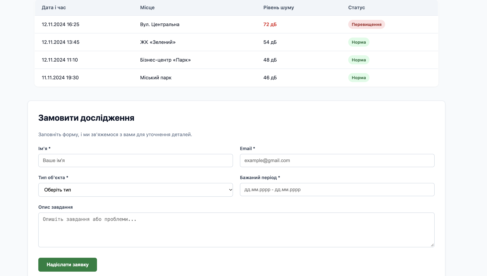

# Лабораторна робота №2
**Верстка сайту компанії згідно з інструкцією (HTML/CSS)**

## 1. Мета роботи
Практично застосувати CSS для оформлення семантичної HTML-структури вебсторінки: підключення зовнішнього CSS, використання селекторів, каскаду, specificity, типів блоків і моделі Box Model.

## 2. Що було реалізовано
- Створено семантичну HTML-структуру вебсторінки «Акустична варта» з використанням тегів `<header>`, `<nav>`, `<main>`, `<section>`, `<article>`, `<aside>`, `<footer>`.
- Підключено зовнішню таблицю стилів `css/style.css`.
- Застосовано різноманітні селектори: елементів, класів, ідентифікаторів, атрибутів, універсальний селектор та групування.
- Налаштовано параметри Box Model (`width`, `height`, `padding`, `margin`, `border`, `box-sizing: border-box`).
- Продемонстровано роботу властивості `display: inline-block` для інформаційних карток напрямів роботи.
- Додано позиціонування (`position: relative` та `position: absolute`) для блоку попереджень і статусних позначок.
- Реалізовано плавні ефекти переходів (`transition`) та трансформації для інтерактивних елементів під час наведення.
- Створено навмисний конфлікт стилів для аналізу каскаду та специфічності (specificity).
- Зроблено публікацію проєкту через GitHub Pages.

## 3. Результат роботи

## 4. Висновок
Під час виконання лабораторної роботи було закріплено практичні навички стилізації вебсторінок за допомогою CSS, освоєно роботу з блоковою моделлю Box Model, різними типами селекторів, механізмами каскаду й специфічності, а також принципами позиціонування елементів.